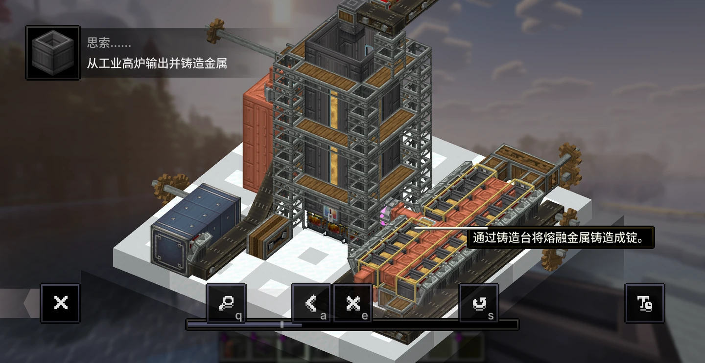

# Genso Metallurgy 0.1.2

幻想机械师：冶金工业（Genso Metallurgy）为 Create 提供工业高炉、熔融金属与铸造流程。需要 Genso Core 0.4.1，目标环境为 Minecraft 1.21.1 / NeoForge 21.1.250 / Create 6.0.10。可独立安装，不要求安装采矿模块。

[返回项目首页](../README.md) · [查看工业高炉的思索教程](#工业高炉的思索教程)

## 内容

- **工业高炉**：可扩展的多方块结构，用于金属熔炼、熔融与熔合，支持 Create 热源和自动化物流。
- **铸造台**：将熔融金属铸造成锭，支持流体输入、自动出料及风流加速。
- **熔融金属**：铜、锌、铁、金、黄铜和下界合金，以及对应的流体桶。
- **材料**：煤粉、粉碎安山合金和安山合金粉。
- **思索教程**：四段教程介绍高炉结构、投入原料、加工和出料铸造。
- **可选联动**：JEI 配方展示、Jade 储存信息显示。

## 当前配方

| 工序 | 原料 | 结果 | 基础时间 |
| --- | --- | --- | --- |
| 粉碎或石磨研磨 | 1 煤炭 | 2 煤粉 | 使用对应 Create 机器 |
| 粉碎 | 1 安山合金 | 1 粉碎安山合金，25% 概率额外 1 件 | 使用 Create 粉碎轮 |
| 高炉熔炼 | 1 铜、锌、铁或金的粉碎矿石 + 1 煤粉 | 180 mB 对应熔融金属 | 10 秒，加热 |
| 高炉熔融 | 1 金属锭或板 | 90 mB 对应熔融金属 | 10 秒 |
| 铸造 | 90 mB 熔融金属 | 1 对应金属锭 | 4 秒 |
| 高炉熔合 | 10 mB 熔融铜 + 10 mB 熔融锌 | 20 mB 熔融黄铜 | 10 秒，加热 |

高炉内置矿石配方仅接收 Create 对应的粉碎矿石，不接收粗矿。锭、板和铸造覆盖现有六种金属；下界合金熔融需要超级加热，其余金属需要加热。板材配方只在对应标签非空时启用，不额外添加板材物品。铸造时间为未受风流加速时的基础时间。

每件煤粉可燃烧 1600 tick，与煤炭相同，但没有变回煤炭的配方。安山合金粉暂未加入配方，机器也暂未加入合成配方。思索中的气体需求属于后续计划，当前没有供气机制。

## 开发入口

在仓库根目录构建或启动本模块，详见 [构建说明](../docs/BUILDING.md)。内置配方位于 `src/main/resources/data/gensometallurgy/recipe/`；煤炭石磨配方使用 `src/main/resources/data/create/recipe/milling/coal.json` 覆盖。生成的模型、标签等资源位于 `src/generated/resources/`。

本模块使用 AI 辅助开发，说明见 [AI_DISCLOSURE.md](../AI_DISCLOSURE.md)。代码与数据采用 MIT，原创模型和贴图采用 CC BY 4.0；熔融金属流体材质来自 **Create: Metallurgy**，沿用其 MIT 许可。具体范围与署名见 [资源许可](../LICENSE-ASSETS.md) 和 [第三方说明](../CREDITS.md)。

## 内容展示

### 工业高炉的思索教程

通过思索教程了解工业高炉的结构与加工流程。图中展示从高炉输出熔融金属，再由铸造台铸造成锭的自动化布局。

