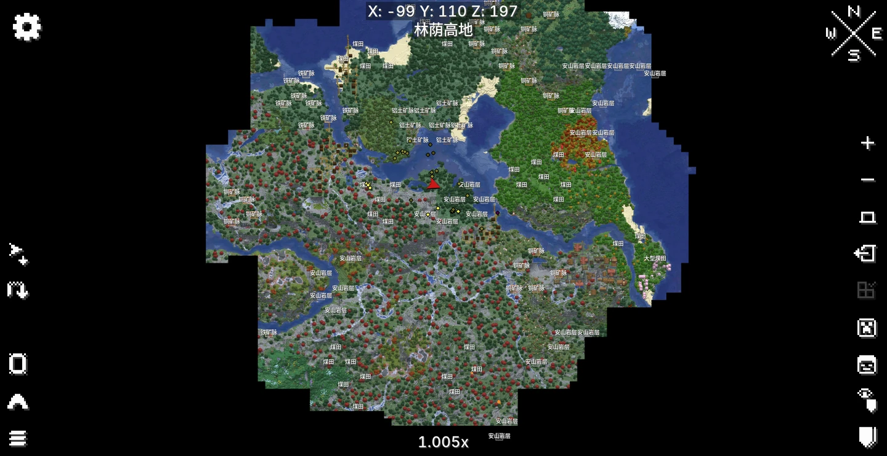
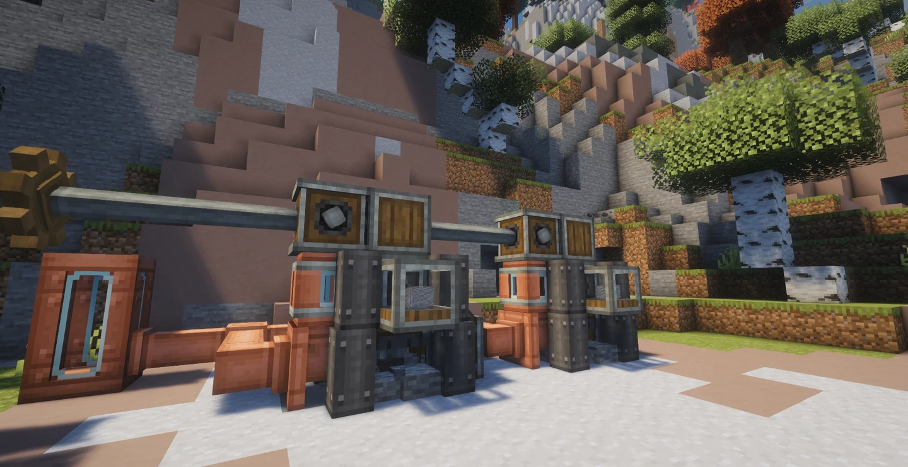
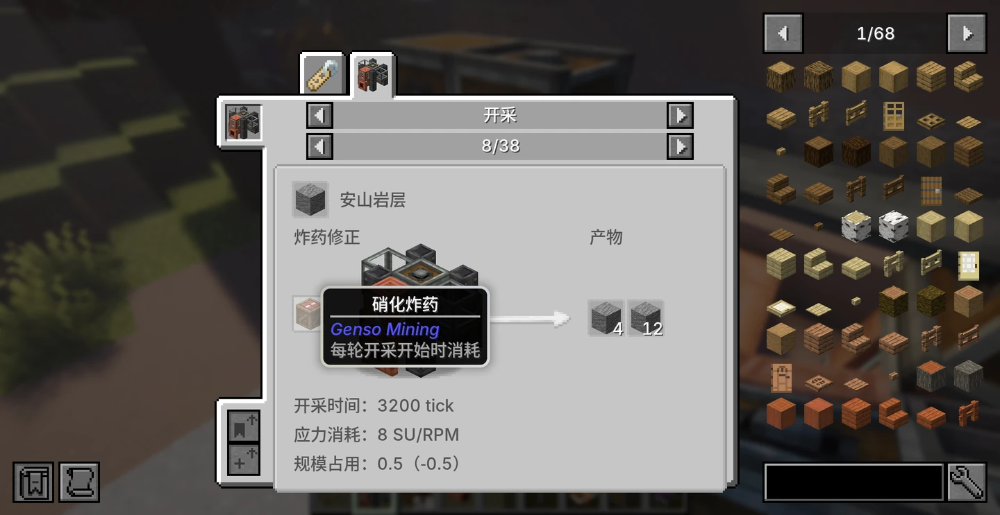
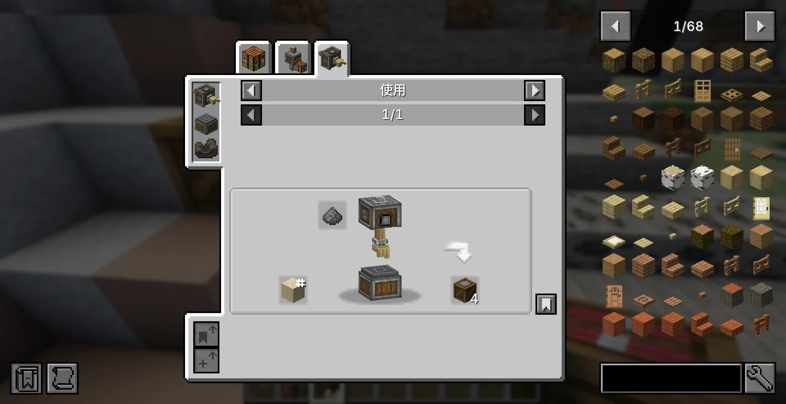
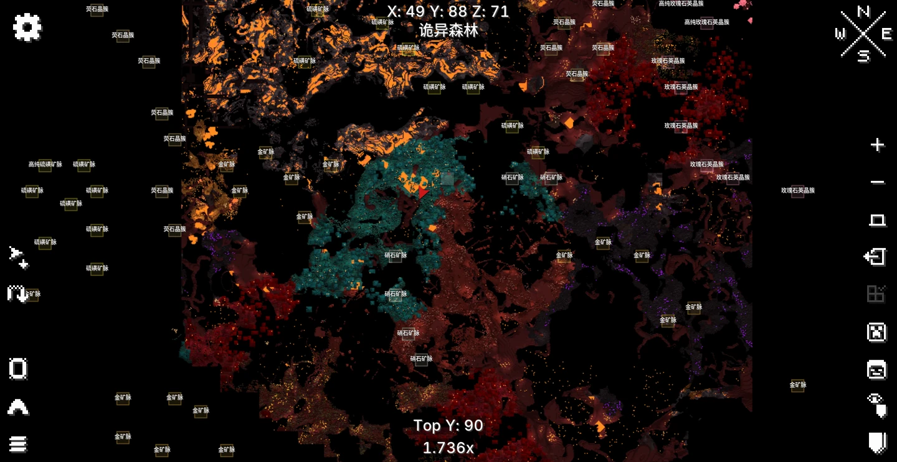
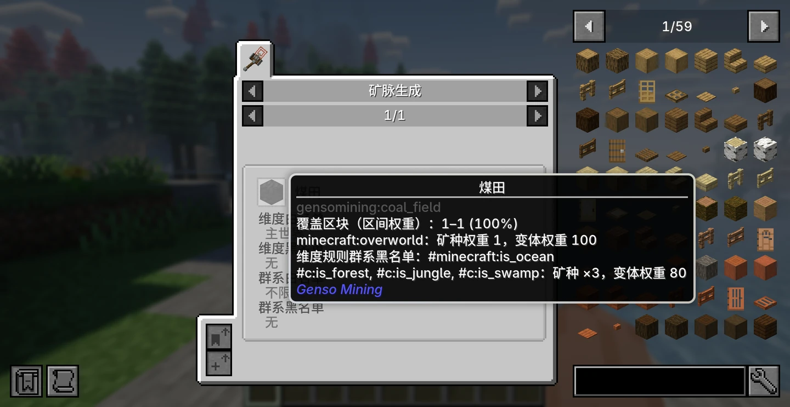

# Genso Mining 0.1.6

Genso Mining 为 Create 提供动力采矿机与地质勘探系统。需要 Genso Core 0.4.1，目标环境为 Minecraft 1.21.1 / NeoForge 21.1.250 / Create 6.0.10。

[返回项目首页](../README.md) · [查看完整图文展示](#内容展示)

## 内容

- **动力采矿机**：使用 Create 动力开采当前区域的矿脉，支持自动输入、输出和流体润滑。
- **地域矿脉**：主世界与下界拥有不同矿种、群系偏好与变体，可通过数据包配置。
- **岩石背景**：在矿脉查询完成且当前区块没有真实矿脉时，按条件启用岩层或下界岩层开采。
- **地质勘探**：扫描器发现矿脉；可选联动 Xaero 地图与勘探档案。
- **采矿炸药**：土制与硝化炸药可点燃，也可作为采矿机的配方修正投入。
- **材料**：包含铝土、粉碎铝土、硫磺、硝石及对应粉末或存储块。
- **可选联动**：JEI 配方展示、Jade 信息显示，以及 Biomes O' Plenty 下界群系联动。

## 当前开采规则

真实矿脉优先于岩石背景；正在等待矿脉查询结果时不会提前启用背景开采。岩石背景不作为扫描或地图上的矿脉目标。

内置配方在流体标签 `#c:plantoil` 非空时使用标签中的植物油，否则使用水。每次润滑消耗 100 mB，开采时间与应力均乘以 0.75。条件在服务端数据重载时解析，JEI 显示当前生效的润滑剂。

下界硝石、硫磺与玫瑰石英的无炸药产率较低，炸药能显著提高收益。下界炸药副产物使用 Create 余烬面粉；主世界继续使用其对应的石料与沙砾副产物。岩石背景没有内置炸药修正。

玫瑰石英晶簇及其高纯变体仅在安装 Biomes O' Plenty 时加入。其余下界矿脉在未安装 BOP 时仍可使用。

## 开发入口

在仓库根目录构建或启动本模块，详见 [构建说明](../docs/BUILDING.md) 与 [测试说明](../docs/TESTING.md)。矿脉、岩石背景和配方的内置 JSON 位于本模块的 `src/main/resources/data/gensomining/`，生成的模型、标签等资源位于 `src/generated/resources/`。

本模块使用 AI 辅助开发，说明见 [AI_DISCLOSURE.md](../AI_DISCLOSURE.md)。代码与数据采用 MIT，原创模型和贴图采用 CC BY 4.0；具体范围见 [资源许可](../LICENSE-ASSETS.md)。

## 内容展示

以下七张游戏截图展示地质勘探、动力开采、炸药自动化与可配置矿脉。

- [地质扫描器探测矿脉](#地质扫描器探测矿脉)
- [Xaero 地图上的矿脉分布](#xaero-地图上的矿脉分布)
- [动力采矿机开采安山岩](#动力采矿机开采安山岩)
- [为采矿机提供炸药](#为采矿机提供炸药)
- [土制炸药的自动生产](#土制炸药的自动生产)
- [下界矿脉与 BOP 联动](#下界矿脉与-bop-联动)
- [可配置的矿脉生成规则](#可配置的矿脉生成规则)

### 地质扫描器探测矿脉

使用地质扫描器寻找附近的矿脉，查看矿种、方向与距离，并了解当前区块的开采容量占用。

### Xaero 地图上的矿脉分布

联动 Xaero 地图，在地图上查看已发现矿脉的名称与分布。图中展示主世界的安山岩层、煤田、铁矿脉、铜矿脉和铝土矿脉。

### 动力采矿机开采安山岩

将动力采矿机部署在安山岩层上，接入 Create 动力，并通过流体接口供给润滑剂，持续开采安山岩。

### 为采矿机提供炸药

土制炸药与硝化炸药可作为开采修正投入采矿机。JEI 展示对应的产物、应力与规模占用；图中为硝化炸药开采安山岩的配方。

### 土制炸药的自动生产

使用 Create 机械手将火药应用到沙子上，一次得到 4 个土制炸药，可接入自动化生产线。

### 下界矿脉与 BOP 联动

下界矿脉具有鲜明的群系偏好。安装 Biomes O' Plenty 后，熔岩炼狱、内脏堆与晶化裂隙分别成为硫磺、硝石与玫瑰石英的高级优势群系；玫瑰石英晶簇及其高纯变体随该联动启用。

### 可配置的矿脉生成规则

通过数据包调整矿脉的维度、群系偏好、生成权重与覆盖规模，并在 JEI 中查看当前生效的生成条件。图中展示煤田的权重与群系标签。

