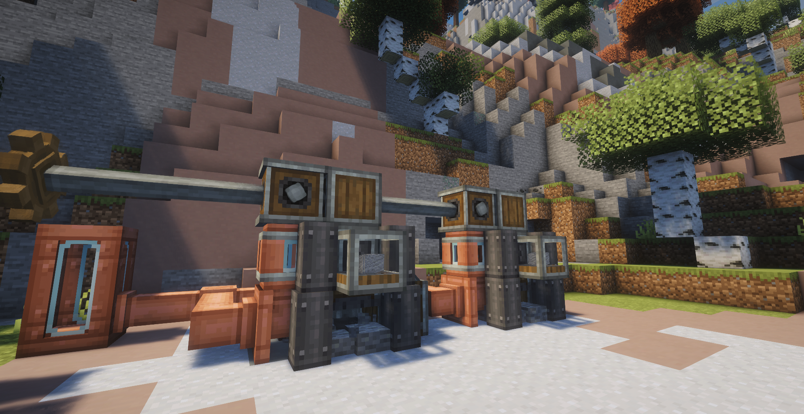

# Genso Mining 0.1.6

Genso Mining 为 Create 提供动力采矿机与地质勘探系统。需要 Genso Core 0.4.1，目标环境为 Minecraft 1.21.1 / NeoForge 21.1.250 / Create 6.0.10。

[返回项目首页](../README.md) · [查看完整图文展示](docs/SHOWCASE.md)

## 内容

- **动力采矿机**：使用 Create 动力开采当前区域的矿脉，支持自动输入、输出和流体润滑。
- **地域矿脉**：主世界与下界拥有不同矿种、群系偏好与变体，可通过数据包配置。
- **岩石背景**：在矿脉查询完成且当前区块没有真实矿脉时，按条件启用岩层或下界岩层开采。
- **地质勘探**：扫描器发现矿脉；可选联动 Xaero 地图与勘探档案。
- **采矿炸药**：土制与硝化炸药可点燃，也可作为采矿机的配方修正投入。
- **材料**：包含铝土、粉碎铝土、硫磺、硝石及对应粉末或存储块。
- **可选联动**：JEI 配方展示、Jade 信息显示，以及 Biomes O' Plenty 下界群系联动。

## 当前开采规则

真实矿脉优先于岩石背景；正在等待矿脉查询结果时不会提前启用背景开采。岩石背景不作为扫描或地图上的矿脉目标。

内置配方在流体标签 `#c:plantoil` 非空时使用标签中的植物油，否则使用水。每次润滑消耗 100 mB，开采时间与应力均乘以 0.75。条件在服务端数据重载时解析，JEI 显示当前生效的润滑剂。

下界硝石、硫磺与玫瑰石英的无炸药产率较低，炸药能显著提高收益。下界炸药副产物使用 Create 余烬面粉；主世界继续使用其对应的石料与沙砾副产物。岩石背景没有内置炸药修正。

玫瑰石英晶簇及其高纯变体仅在安装 Biomes O' Plenty 时加入。其余下界矿脉在未安装 BOP 时仍可使用。

## 开发入口

在仓库根目录构建或启动本模块，详见 [构建说明](../docs/BUILDING.md) 与 [测试说明](../docs/TESTING.md)。矿脉、岩石背景和配方的内置 JSON 位于本模块的 `src/main/resources/data/gensomining/`，生成的模型、标签等资源位于 `src/generated/resources/`。

本模块使用 AI 辅助开发，说明见 [AI_DISCLOSURE.md](../AI_DISCLOSURE.md)。代码与数据采用 MIT，原创模型和贴图采用 CC BY 4.0；具体范围见 [资源许可](../LICENSE-ASSETS.md)。
