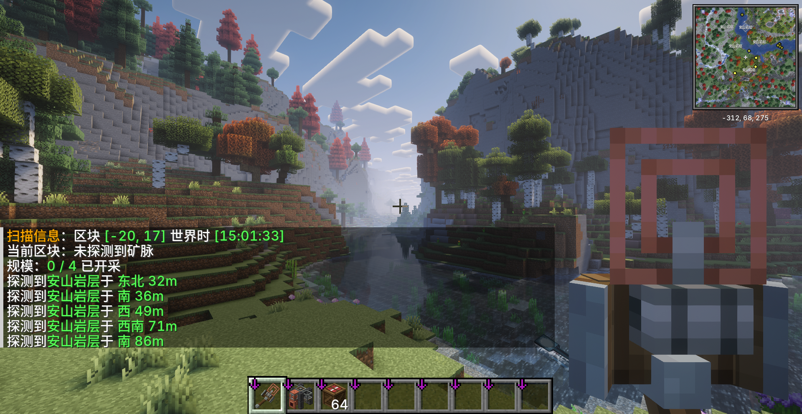
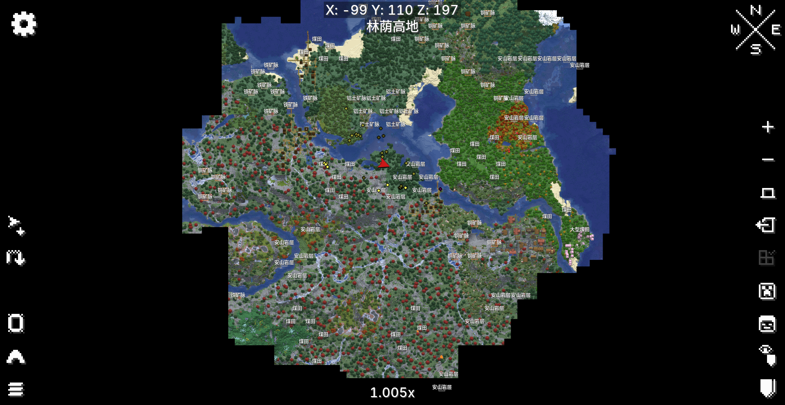
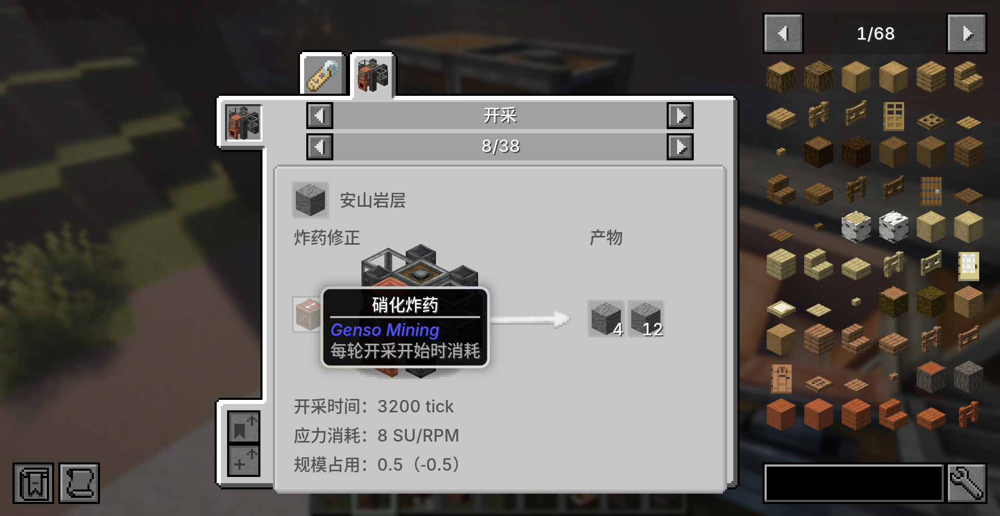
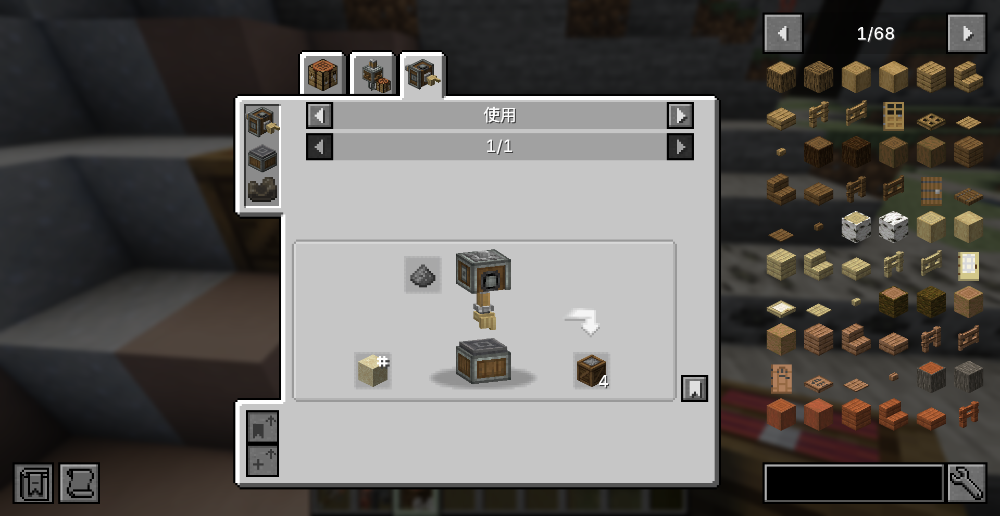
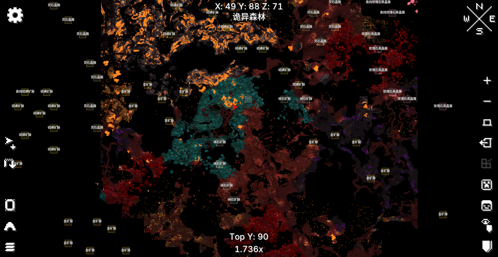
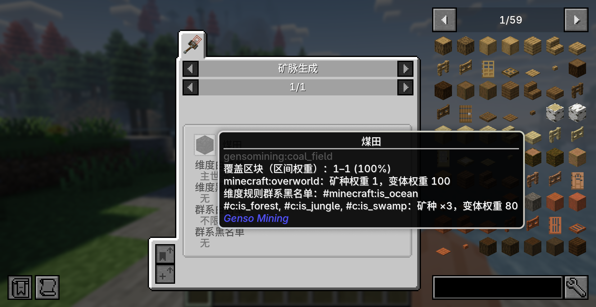

# Genso Mining 内容展示

[返回项目首页](../../README.md) · [采矿模块介绍](../README.md)

以下七张游戏截图展示地质勘探、动力开采、炸药自动化与可配置矿脉。

- [地质扫描器探测矿脉](#地质扫描器探测矿脉)
- [Xaero 地图上的矿脉分布](#xaero-地图上的矿脉分布)
- [动力采矿机开采安山岩](#动力采矿机开采安山岩)
- [为采矿机提供炸药](#为采矿机提供炸药)
- [土制炸药的自动生产](#土制炸药的自动生产)
- [下界矿脉与 BOP 联动](#下界矿脉与-bop-联动)
- [可配置的矿脉生成规则](#可配置的矿脉生成规则)

## 地质扫描器探测矿脉

使用地质扫描器寻找附近的矿脉，查看矿种、方向与距离，并了解当前区块的开采容量占用。

## Xaero 地图上的矿脉分布

联动 Xaero 地图，在地图上查看已发现矿脉的名称与分布。图中展示主世界的安山岩层、煤田、铁矿脉、铜矿脉和铝土矿脉。

## 动力采矿机开采安山岩

将动力采矿机部署在安山岩层上，接入 Create 动力，并通过流体接口供给润滑剂，持续开采安山岩。

## 为采矿机提供炸药

土制炸药与硝化炸药可作为开采修正投入采矿机。JEI 展示对应的产物、应力与规模占用；图中为硝化炸药开采安山岩的配方。

## 土制炸药的自动生产

使用 Create 机械手将火药应用到沙子上，一次得到 4 个土制炸药，可接入自动化生产线。

## 下界矿脉与 BOP 联动

下界矿脉具有鲜明的群系偏好。安装 Biomes O' Plenty 后，熔岩炼狱、内脏堆与晶化裂隙分别成为硫磺、硝石与玫瑰石英的高级优势群系；玫瑰石英晶簇及其高纯变体随该联动启用。

## 可配置的矿脉生成规则

通过数据包调整矿脉的维度、群系偏好、生成权重与覆盖规模，并在 JEI 中查看当前生效的生成条件。图中展示煤田的权重与群系标签。

